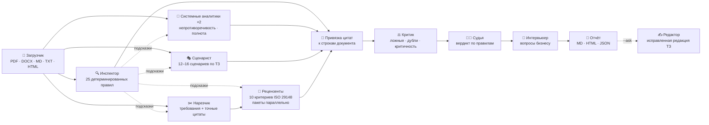

# 🐝 SoloHive — рой ИИ-агентов для проверки требований

**Команда SoloHive · BCC-HUB x MNU FinTech Hackathon 2026 · Agent Challenge**

**▶️ Демо-видео (3:04, со звуком):** [youtu.be/H9gl-FcdDMI](https://youtu.be/H9gl-FcdDMI) · **Презентация:** [`docs/SoloHive_presentation.pdf`](docs/SoloHive_presentation.pdf)

> **Для жюри.** В заявке — отчёт по выданному `requirements.md`: **39 из 40 (98%)**. В демо-видео — прогон по PDF-версии того же документа с режимом уточнения: **38 из 40 (95%)**. Оба отчёта сгенерированы агентом и лежат в `reports/`; чем отличаются прогоны и почему — в разделе [«Два прогона: что где и почему цифры отличаются»](#два-прогона-что-где-и-почему-цифры-отличаются).

SoloHive проводит **статическую проверку документа с требованиями до разработки**: нарезает документ на отдельные требования, проверяет каждое и весь набор по **ISO/IEC/IEEE 29148:2018 (п. 5.2.5, 5.2.6)** и **IEEE Std 830-1998 (п. 4.3)**, проигрывает ТЗ на конкретных сценариях, задаёт уточняющие вопросы бизнесу и выпускает доказательный отчёт на русском языке. Каждое замечание ссылается на точное место в документе: раздел, номер строки и страницу PDF. По ответам на вопросы агент пишет **исправленную редакцию ТЗ**.

> Один участник — целый рой агентов. Каждая «пчела» отвечает за свой этап, а оркестратор собирает результаты, проверяет их и отбрасывает всё, что не подтверждено текстом документа.

### Результат на тестовом документе организаторов

Модель: `gemini-3.8-flash` через OpenRouter. Оба прогона лежат в [`reports/`](reports/).

**Прогон по выданному документу `requirements.md`** — команда из заявки:

```bash
python -m solohive --input examples/requirements.md --output reports/requirements_report.md
```

| Показатель | Значение |
| :--- | :--- |
| Найдено дефектов из контрольного списка эксперта (40 шт.) | **39 (98%)** |
| Требований выделено | 36, каждое с точной цитатой и номерами строк |
| Нарушений в отчёте | 59: 🔴 5 · 🟡 39 · 🟢 15. Все 126 ссылок на строки совпадают со строками `requirements.md` |
| Вердикт | разработка ⛔ НЕ ГОТОВ · тестирование ⛔ НЕ ГОТОВ; 12 уточняющих вопросов |
| Отчёт | [`reports/requirements_report.md`](reports/requirements_report.md) — в формате входа; рядом [`.html`](reports/requirements_report.html) и [`.json`](reports/requirements_report.json) |
| Время | ≈ 4,7 мин |

**Прогон по PDF-версии того же документа с режимом уточнения (`--ask`)** — PDF на входе, PDF на выходе; этот прогон показан в демо-видео:

| Показатель | Значение |
| :--- | :--- |
| Найдено дефектов из контрольного списка эксперта (40 шт.) | **38 (95%)** |
| Требований выделено | 40, каждое с точной цитатой и номерами строк |
| Нарушений в отчёте | 55: 🔴 6 · 🟡 37 · 🟢 12. Каждое с цитатой и номером строки |
| Критичные (CRITICAL) | 6: противоречие Ф-2 и критерия приёмки, цель «в момент покупки» против учёта по проведению, HTTP GET для записи, 200 с ошибкой в теле, обещанное чтение без метода чтения (и сумма за месяц на экране без источника) |
| Вердикт до уточнения | разработка ⛔ НЕ ГОТОВ · тестирование ⛔ НЕ ГОТОВ |
| Уточнение (`--ask`) | 11 вопросов → 11 ответов → устранено 32 дефекта, в том числе **все 6 критичных** |
| Вердикт после уточнения | разработка ⚠️ ГОТОВ С УСЛОВИЯМИ · тестирование ⚠️ ГОТОВ С УСЛОВИЯМИ |
| Отчёт | [`reports/report.pdf`](reports/report.pdf): на первой странице «Кратко» — вердикт до и после уточнения, 6 блокеров и как каждый закрыт, что осталось доуточнить. Он же в [`.docx`](reports/report.docx), [`.md`](reports/report.md), [`.html`](reports/report.html), [`.json`](reports/report.json) |
| Исправленное ТЗ | [`reports/report_revised.pdf`](reports/report_revised.pdf) (и [`.md`](reports/report_revised.md)): «было → стало», 5 новых требований, 7 критериев приёмки |
| Демо-видео | [youtu.be/H9gl-FcdDMI](https://youtu.be/H9gl-FcdDMI), 3:04 со звуком: запуск одной командой, работа роя, вопросы агента и ответы, отчёт в PDF и HTML, исправленное ТЗ, тесты и CI |
| Презентация | [`docs/SoloHive_presentation.pdf`](docs/SoloHive_presentation.pdf): 10 слайдов — проблема, рой агентов, проверка цитат, демо, результат 39 из 40 по requirements.md, режим уточнения, что получает команда, качество и запуск |
| Время и стоимость | ≈ 3,5 мин анализа + ≈ 40 с на исправленное ТЗ, ≈ $0.45 за прогон (12 вызовов LLM, ~120 тыс. токенов на вход) |

### Два прогона: что где и почему цифры отличаются

| | Прогон 1 — по выданному `requirements.md` | Прогон 2 — по PDF-версии с уточнением |
| :--- | :--- | :--- |
| Где использован | **В заявке:** команда запуска и файл отчёта | **В демо-видео** и на слайдах про уточнение |
| Команда | `python -m solohive --input examples/requirements.md --output reports/requirements_report.md` | `python -m solohive --input examples/requirements.pdf --output reports/report.pdf --ask` |
| Отчёт | [`reports/requirements_report.md`](reports/requirements_report.md) | [`reports/report.pdf`](reports/report.pdf) + исправленное ТЗ |
| Полнота по контрольному списку | **39 из 40 (98%)**, пропущен G34 | **38 из 40 (95%)**, пропущены G18 и G22 |
| Требований / нарушений | 36 / 59 (🔴 5 · 🟡 39 · 🟢 15) | 40 / 55 (🔴 6 · 🟡 37 · 🟢 12) |
| Вердикт | ⛔ НЕ ГОТОВ, 12 вопросов | ⛔ НЕ ГОТОВ → после 11 ответов ⚠️ ГОТОВ С УСЛОВИЯМИ |
| Номера строк в отчёте | строки `requirements.md` (все 126 ссылок совпадают) | строки текстового слоя PDF и номер страницы |

**Почему цифры отличаются:**
- **Документ один и тот же.** `examples/requirements.md` совпадает с выданным файлом байт в байт, PDF сделан из него. Агент записывает имя файла и его SHA-256 в паспорт каждого отчёта.
- **Разная разметка входа.** В Markdown есть заголовки и таблицы, в PDF — сплошной текстовый слой со страницами. Поэтому нарезчик делит документ на 36 и 40 требований, а номера строк в PDF-отчёте относятся к PDF, а не к `.md`. Сверять ссылки с `requirements.md` нужно по прогону 1.
- **LLM недетерминирована.** Даже при температуре 0,2 агенты формулируют и группируют находки немного по-разному. Пример: в прогоне 2 одна проблема — в API нет метода чтения — оформлена двумя критичными карточками («сумма за месяц на экране не обеспечена методом чтения» и «документ обещает чтение, а в API только изменение»), в прогоне 1 — одной. Поэтому критичных 6 и 5, а сами критичные дефекты те же: цель «в момент покупки», противоречие Ф-2 и критерия приёмки, GET для записи, ошибка при ответе 200, нет метода чтения.
- **Пропуски не совпадают.** Прогон 1 пропустил G34, прогон 2 — G18 и G22; вместе прогоны покрывают все 40 дефектов контрольного списка. Это показывает, что потери случайны, а не системны.
- **Детерминированная часть одинакова.** 25 правил без LLM, сверка цитат кодом и вердикт по правилам работают одинаково в обоих прогонах: оба вердикта — «не готов» по одной причине (критичные дефекты), у каждой находки есть подтверждённая цитата.

Проверить полноту любого прогона можно одной командой: `python -m solohive.evaluate reports/requirements_report.json` и `python -m solohive.evaluate reports/report.json`.

---

## Быстрый старт (3 шага)

**Требования:** Python **3.9+** (macOS / Linux / Windows), интернет для доступа к LLM.

```bash
# 1. Установить зависимости
git clone <ссылка-на-этот-репозиторий> solohive && cd solohive
python3 -m venv .venv && source .venv/bin/activate      # Windows: .venv\Scripts\activate
pip install -r requirements.txt

# 2. Положить ключ LLM (бесплатный ключ Gemini)
cp .env.example .env                                    # Windows: copy .env.example .env
#    откройте .env и впишите GEMINI_API_KEY=...

# 3. Запустить проверку одной командой (выданный документ requirements.md → отчёт в Markdown)
python -m solohive --input examples/requirements.md --output reports/requirements_report.md
#    тот же документ в PDF → отчёт в PDF:
#    python -m solohive --input examples/requirements.pdf --output reports/report.pdf
```

Результат прогона:
- **`reports/requirements_report.md`** — отчёт по разделу 6 ТЗ в формате входного документа. Открывается разделом «Кратко»: главное для руководителя на одной странице;
- **`reports/requirements_report.html`** — тот же отчёт в интерактивном виде: дефекты рядом с размеченным документом, фильтры, поиск, матрица, сценарии. Откройте в браузере, работает офлайн;
- **`reports/requirements_report.json`** — машиночитаемая версия для CI и других систем.

Формат отчёта задаётся расширением `--output`: `.pdf`, `.docx` (Word), `.md`, `.html`, `.json`. Без `--output` отчёт выходит **в формате входного документа**: PDF → PDF, DOCX → DOCX, Markdown → Markdown. Пример PDF-прогона с уточнением — [`reports/report.pdf`](reports/report.pdf): кликабельное оглавление в боковой панели, ссылки от «Кратко» к карточкам требований; рядом тот же отчёт в [`.docx`](reports/report.docx), [`.md`](reports/report.md), [`.html`](reports/report.html), [`.json`](reports/report.json) и исправленное ТЗ.

Готовый отчёт можно перевыпустить в другом формате без нового прогона модели: `python -m solohive.render reports/report.json reports/report.docx`.

Ход работы роя виден в консоли.

### Режим уточнения: агент спрашивает — вы отвечаете — агент исправляет ТЗ

```bash
python -m solohive --input examples/requirements.pdf --output reports/report.pdf --ask
```

После проверки агент задаёт уточняющие вопросы прямо в консоли (ответ — текстом или буквой варианта, Enter — пропустить). Затем агент-редактор пересматривает дефекты (устранён / частично / открыт), пересчитывает вердикт и выпускает **`reports/report_revised.pdf`** (в формате отчёта, плюс `.md`) — исправленную редакцию требований («было → стало», новые требования, критерии приёмки). Ответы сохраняются в `reports/report_answers.json`. Повторить без диалога можно так: `--answers reports/report_answers.json`.

### Запуск в Docker (по желанию)

```bash
docker build -t solohive .
docker run --rm --env-file .env -v "$PWD/reports:/app/reports" solohive \
  --input examples/requirements.md --output reports/requirements_report.md
```

### Как получить ключ LLM
1. Откройте [Google AI Studio → API keys](https://aistudio.google.com/apikey) и войдите в Google-аккаунт.
2. Нажмите **Create API key** и скопируйте ключ.
3. Вставьте его в файл `.env` в корне проекта: `GEMINI_API_KEY=ваш_ключ`.

Бесплатного тарифа достаточно. Файл `.env` в git не попадает. В репозитории есть только пример `.env.example` без ключа.

### Команда запуска

```bash
python -m solohive --input <путь к требованиям> --output <путь к отчёту>
# или короче:
python -m solohive <путь к требованиям> <путь к отчёту>
```

| Параметр | Назначение |
| :--- | :--- |
| `--input`, `-i` | Файл требований: **PDF**, DOCX, Markdown, TXT, HTML |
| `--output`, `-o` | Файл отчёта: `.pdf`, `.docx`, `.md`, `.html` или `.json`. Без параметра: `reports/<имя>_report` в формате входного файла |
| `--model` | Другая модель, например `--model gemini-3.6-flash` |
| `--provider` | `gemini` (по умолчанию), `openrouter`, `openai`, `anthropic`, `ollama` |
| `--fast` | Быстрый режим: короткие рассуждения модели, крупные пакеты |
| `--ask` | После проверки задать уточняющие вопросы в консоли и выпустить исправленную редакцию ТЗ |
| `--answers FILE` | То же без диалога: ответы из файла (JSON `{"Q-01": "…"}` или строки `Q-01: ответ`) |
| `--offline` | Без LLM: только детерминированные правила (если нет ключа или сети) |
| `--no-cache` | Не использовать кэш ответов LLM |

---

## Модель

По умолчанию используется **Google Gemini `gemini-3.8-flash`** через бесплатный ключ AI Studio. Если основная модель перегружена, недоступна на вашем тарифе или исчерпала квоту, агент **сам переключается** на запасные (`gemini-3.6-flash` → `gemini-3.5-flash-lite`) и записывает фактически использованную модель в паспорт отчёта. Модели настраиваются в `.env` (`GEMINI_MODEL`, `GEMINI_FALLBACK_MODELS`).

### Те же модели через OpenRouter

Если бесплатных лимитов Gemini мало, а подключать оплату в AI Studio неудобно, ту же `gemini-3.8-flash` можно вызывать через [OpenRouter](https://openrouter.ai): один ключ, оплата картой от $5, цены моделей те же, что у Google. Полный прогон стоит порядка десятков центов.

```bash
# .env
LLM_PROVIDER=openrouter
OPENROUTER_API_KEY=ваш_ключ            # https://openrouter.ai/settings/keys
# OPENROUTER_MODEL=google/gemini-3.8-flash            (по умолчанию)
# OPENROUTER_FALLBACK_MODELS=google/gemini-3.6-flash  (по умолчанию)
```

Агент обрабатывает ответы OpenRouter так же, как ответы Gemini: при перегрузке (5xx) переключается на запасную модель, при 429 ждёт, а при **402** (закончились кредиты) сразу останавливается с понятным сообщением.

Поддерживаются и другие провайдеры: OpenAI и совместимые API (DeepSeek, vLLM), Anthropic Claude (`pip install anthropic`), локальные модели через Ollama. Примеры есть в `.env.example`.

> Пример `.env.example` организаторов указывает `gemini-1.5-flash`. Эта модель уже отключена в Gemini API, поэтому SoloHive использует актуальные модели.

### Если Gemini перегружен или закончилась квота

Бесплатные лимиты Gemini свои у каждого проекта, их можно посмотреть в [AI Studio → Rate limits](https://aistudio.google.com/rate-limit). Агент сам справляется с типовыми сбоями:

| Ответ Gemini | Что делает агент |
| :--- | :--- |
| **503** «high demand» (перегрузка) | Модель «остывает» 8–45 с, текущий запрос сразу уходит на запасную модель. Потом агент возвращается на основную |
| Оборванный ответ (1–2 токена, не STOP) | Считается сбоем и повторяется, а не отправляется на «ремонт» |
| **429** минутный лимит | Ждёт ровно `retryDelay` из ответа Google и повторяет запрос |
| **429** нет квоты, **404** нет модели | Исключает модель до конца прогона |
| Не отвечает ни одна модель | За секунды доводит отчёт на детерминированных правилах и пишет это в отчёт |

**Повторный прогон дозаполняет отчёт.** В кэш попадают только корректные ответы модели. Если часть этапов не успела из-за перегрузки, просто повторите ту же команду: готовые части возьмутся из кэша мгновенно, а запросы уйдут только за недостающим. Пауза ожидания видна в консоли строкой «⏳ Gemini перегружен, жду N с…».

Если основная модель долго перегружена, можно сразу выбрать лёгкую: `--model gemini-3.5-flash-lite` (быстрее, чуть менее глубоко).

---

## Архитектура: рой агентов



| Агент | Что делает | LLM |
| :--- | :--- | :---: |
| 📄 **Загрузчик** | Приводит PDF/DOCX/MD/TXT/HTML к единой структуре: строки с номерами, разделы, таблицы, страницы PDF | — |
| 🔍 **Инспектор** | 25 общих правил без LLM: GET для изменения данных, 2xx с телом ошибки, неописанные коды ответов, обещанное чтение без метода чтения, неполные критерии приёмки, тиыны/тенге без пересчёта, разные типы одного параметра, часовой пояс, НФТ без перцентиля, НФТ, которое меряет внутреннюю передачу вместо результата для клиента, заглушки, пустые разделы и таблицы, версия, ID, термины, размытые слова | — |
| ✂️ **Нарезчик** | Выделяет отдельные требования, сохраняет ID документа (Ф-1…) или присваивает свой, хранит точную цитату и строки | ✓ |
| 🧭 **Системные аналитики** | Два независимых взгляда на набор: (1) противоречия между разделами, целями и приёмкой, прослеживаемость; (2) полнота процесса, API, данных, НФТ, стандарты | ✓ |
| 🎭 **Сценарист** | Проигрывает ТЗ на 12–16 конкретных сценариях (граница месяца, возврат, повторное событие, отказ сервиса, чужая карта…) и проверяет, определяет ли документ результат | ✓ |
| 🔬 **Рецензенты** | Проверяют каждое требование по 10 критериям, предлагают исправленную формулировку и тест-кейсы | ✓ |
| ⚖️ **Критик** | Независимая проверка: убирает ложные срабатывания, объединяет дубликаты, калибрует критичность | ✓ |
| 👩‍⚖️ **Судья** | Детерминированный вердикт: одинаковые находки всегда дают одинаковое решение | — |
| 💬 **Интервьюер** | Формирует уточняющие вопросы к бизнесу, аналитику, архитектору, ИБ, с вариантами ответа | ✓ |
| ✍️ **Редактор** | В режиме `--ask` по ответам пересматривает дефекты и пишет исправленную редакцию требований | ✓ |

Детерминированные правила работают первыми и мгновенно. Их находки передаются LLM-агентам как подсказки: модель не тратит внимание на повторы и ищет смысловые дефекты, которые правилами не ловятся.

**Скорость.** Независимые агенты работают параллельно: нарезка, системный анализ и сценарист стартуют одновременно, рецензенты обрабатывают пакеты требований параллельно. Весь прогон — около 12 вызовов LLM в 4 последовательных раунда. Повторный прогон того же документа мгновенно берёт ответы из кэша.

**Надёжность.** Умная маршрутизация между моделями: при перегрузке (503) запрос уходит на запасную модель и потом возвращается на основную; при 429 агент ждёт ровно `retryDelay`; модель без квоты исключается; если LLM недоступна целиком, «предохранитель» за секунды завершает прогон на правилах. Невалидный JSON отправляется модели на исправление. Если отдельный агент сбоит, прогон не падает: отчёт строится из остального, а предупреждение попадает в отчёт.

### Как агент борется с галлюцинациями

1. **Каждая цитата сверяется с документом.** Сначала ищется точное совпадение после нормализации регистра, кавычек, тире, разметки и пробелов в числах «1 000», затем нечёткое (≥ 87%). Находка без подтверждённой цитаты отбрасывается и попадает в журнал верификации.
2. **Номера строк вычисляет код, а не модель.** Ссылка «раздел › подраздел · строка N» строится по найденной цитате.
3. **Критик — отдельный агент**, который не писал находки и проверяет их заново.
4. **Правила — детерминированная страховка**: ключевые нарушения стандартов найдутся даже при слабой модели.
5. **Вердикт выносят правила, а не модель**: есть CRITICAL — разработка не готова; есть MAJOR — готова с условиями.

---

## Состав отчёта

Отчёт строго по разделу 6 ТЗ, на русском языке. Открывается разделом **«Кратко»** на одну страницу: вывод одним абзацем, вердикт до и после уточнения, таблица критичных дефектов со ссылками на подробности и статусом после ответов, главные открытые вопросы и как получен результат (сколько кандидатов отсеяно проверкой цитат и критиком). Раздел собирается из данных прогона без LLM, поэтому всегда совпадает с подробной частью.

1. **Паспорт прогона:** документ, SHA-256 файла, дата, модель, версия агента (коммит git), время, число вызовов LLM и токены.
2. **Как агент нарезал требования:** таблица «ID в отчёте — ID в документе — раздел — тип — краткая формулировка — точная цитата — строки».
3. **Проверка каждого требования:** матрица по 10 критериям и карточка каждого требования с дефектами (цитата, место, почему это проблема, как исправить), исправленной формулировкой и идеями приёмочных тестов.
4. **Проверка всего набора:** 8 критериев набора (ISO 29148 п. 5.2.6, IEEE 830), системные дефекты с цитатами из нескольких мест и **сценарный анализ** (сценарии с итогом «определено / не определено / противоречиво»).
5. **Сводка:** число требований и нарушений, распределение по критичности и критериям, список критичных дефектов, непроверяемые, противоречивые и неполные формулировки.
6. **Уточняющие вопросы:** по адресатам, с вариантами ответа и связью с дефектами.
7. **Итог:** можно ли начинать разработку и тестирование, что исправить в первую очередь.

8. **Уточнение** (в режиме `--ask`): ответы, пересмотр дефектов, что остаётся открытым, вердикт после правок, исправленная редакция требований.

Приложения: журнал верификации (что отброшено и почему), ход прогона по агентам и вызовам LLM, методика.

Критичность: 🔴 **CRITICAL** — блокер: противоречие, нарушение стандарта протокола, обещанная, но отсутствующая функция, риск ошибки с деньгами; 🟡 **MAJOR** — неполнота и двусмысленность, доуточнить до спринта; 🟢 **MINOR** — исправить в рабочем порядке.

---

## Проверка качества

```bash
pip install pytest
python -m pytest -q                    # 63 теста: загрузчики, правила, LLM-слой и устойчивость к сбоям, незнакомые ТЗ, сквозной прогон, форматы, уточнение
```

Тесты проверяют, в частности:
- PDF, DOCX и Markdown дают одинаковую структуру;
- правила срабатывают во всех форматах и **не дают ложных срабатываний** на качественном ТЗ;
- агент обобщается на **незнакомые ТЗ** другого стиля: PDF из Word, текст без разметки, другая нумерация;
- выдуманные моделью цитаты и требования отбрасываются;
- формат REST-запроса к Gemini, автозамена модели при 404, ожидание при 429;
- отчёт содержит все разделы ТЗ и выпускается в PDF и DOCX с кириллицей; формат по умолчанию совпадает с форматом входа;
- «Кратко» открывает отчёт и показывает вердикт до и после уточнения; оглавление PDF и внутренние ссылки PDF и DOCX ведут на существующие страницы и закладки.

Полнота отчёта сверяется с контрольным списком эксперта (40 дефектов учебного документа). Агент этот файл не читает:

```bash
python -m solohive.evaluate reports/requirements_report.json   # прогон по requirements.md: 39/40 (98%)
python -m solohive.evaluate reports/report.json                # прогон по PDF: 38/40 (95%)
```

---

## Структура репозитория

```
solohive/
├── solohive/
│   ├── cli.py              # запуск одной командой
│   ├── pipeline.py         # оркестратор роя (граф выполнения, параллелизм)
│   ├── loaders.py          # PDF / DOCX / MD / TXT / HTML → единая структура
│   ├── document.py         # строки, разделы, таблицы, поиск цитат (точный и нечёткий)
│   ├── linters.py          # 🔍 детерминированные правила
│   ├── criteria.py         # критерии ISO 29148 / IEEE 830 и шкала критичности
│   ├── agents/             # ✂️ нарезчик, 🔬 рецензенты, 🧭 аналитики, 🎭 сценарист, ⚖️ критик, 💬 интервьюер, ✍️ редактор
│   ├── prompts/            # промпты агентов (Markdown, на русском)
│   ├── llm/                # Gemini (REST), OpenAI-совместимые, Anthropic; повторы, кэш, автозамена модели
│   ├── report/             # отчёт: Markdown, PDF, DOCX, интерактивный HTML, JSON
│   ├── fonts/              # шрифт DejaVu (кириллица, ₸) для PDF
│   ├── render.py           # перевыпуск отчёта из JSON в другом формате
│   └── evaluate.py         # оценка полноты по контрольному списку
├── examples/               # проверяемый документ организаторов (MD, PDF, DOCX)
├── reports/                # отчёты прогонов
├── docs/                   # презентация проекта (PDF, 10 слайдов)
├── eval/gold_defects.yaml  # контрольный список дефектов эксперта
├── tests/                  # pytest
├── .env.example            # пример конфига без ключа
└── requirements.txt
```

## Ограничения

- Сканы PDF без текстового слоя не поддерживаются: нужен PDF с текстом (OCR вне рамок задачи).
- Модель может пропустить тонкий смысловой дефект. Поэтому используются два независимых системных взгляда, рецензенты и правила. Полнота измеряется контрольным списком.
- Ответы LLM недетерминированы. Температура 0,2 и детерминированный вердикт делают результат стабильным, но формулировки и счёт находок между прогонами могут отличаться: на этом документе полнота держится на уровне 38–39 из 40.

---

*SoloHive · MIT License · BCC-HUB x MNU FinTech Hackathon 2026*
